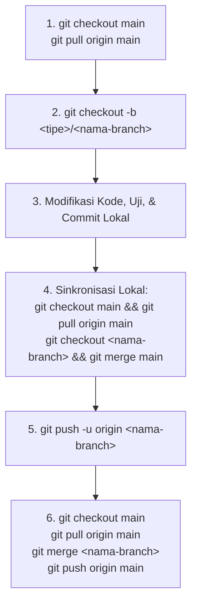

# 📋 Aturan Alur Kerja Git Kreavana (Kreavana Git Workflow Rules)

Dokumen ini berisi aturan wajib bagi seluruh developer, kontributor, dan AI Coding Assistant (Antigravity, Copilot, Cursor, dsb.) dalam mengelola branch, sinkronisasi, dan commit di repositori **Kreavana**.

---

## 🎯 Prinsip Utama
> **SETIAP PERUBAHAN** yang ingin di-push ke branch baru atau di-merge ke branch `main`, **WAJIB** melakukan `git pull origin main` terlebih dahulu di branch `main`, memastikan mengambil seluruh update terbaru dari remote, melakukan merge lokal untuk memastikan tidak ada konflik, baru kemudian melakukan push ke branch baru, dan selanjutnya merge serta push ke branch `main`.

---

## 🔄 Prosedur Wajib 6 Langkah (Mandatory 6-Step Workflow)

Setiap pengerjaan fitur, perbaikan bug, atau revisi kode harus melalui urutan langkah berikut secara berurutan:



### Langkah 1: Ambil Update Terbaru di Branch `main`
Sebelum memulai pekerjaan atau membuat branch baru:
```bash
git checkout main
git pull origin main
```
*Pastikan tidak ada commit atau file tertinggal, dan working tree lokal dalam kondisi bersih (`clean`).*

### Langkah 2: Buat Branch Baru dari `main` yang Sudah Terkini
Gunakan format penamaan branch konvensional:
* `feature/<nama-fitur>`: Penambahan fitur baru.
* `fix/<nama-bug>`: Perbaikan bug atau kendala.
* `refactor/<nama-komponen>`: Restrukturisasi atau pembersihan kode.
* `chore/<kegiatan>`: Konfigurasi, dependensi, atau dokumentasi.

Contoh:
```bash
git checkout -b feature/add-export-csv
```

### Langkah 3: Lakukan Perubahan & Commit di Branch Baru
Pastikan kode telah diuji secara lokal (misal syntax check PHP / `flutter analyze`) sebelum dicommit:
```bash
git add <file-yang-dimodifikasi>
git commit -m "tipe(scope): deskripsi perubahan yang jelas dan padat"
```

### Langkah 4: Wajib Sinkronisasi & Merge Lokal dengan `main` Terbaru Sebelum Push
Sebelum melakukan push branch ke remote origin:
1. Pastikan kembali apakah ada commit baru yang masuk ke remote `main`:
   ```bash
   git checkout main
   git pull origin main
   ```
2. Kembali ke branch kerja dan lakukan merge lokal dari `main`:
   ```bash
   git checkout <nama-branch>
   git merge main
   ```
3. Selesaikan konflik (*merge conflict*) secara lokal jika ada, lalu pastikan build/analisis tetap hijau.

### Langkah 5: Push Branch Baru ke Remote Origin
Setelah branch kerja terbukti sinkron dengan `main` dan bebas konflik:
```bash
git push -u origin <nama-branch>
```

### Langkah 6: Merge ke `main` & Push ke Remote Origin
1. Beralih ke branch `main`:
   ```bash
   git checkout main
   ```
2. Lakukan verifikasi pull sekali lagi:
   ```bash
   git pull origin main
   ```
3. Lakukan merge branch kerja ke `main`:
   ```bash
   git merge <nama-branch>
   ```
4. Push perubahan `main` ke remote repository:
   ```bash
   git push origin main
   ```

---

## 🚫 Larangan Keras (Strict Prohibitions)
1. ❌ **Dilarang langsung push branch baru tanpa pull `main` terbaru dan merge lokal terlebih dahulu.**
2. ❌ **Dilarang push ke `main` tanpa melakukan `git pull origin main` terlebih dahulu.**
3. ❌ **Dilarang melakukan Force Push (`git push -f` / `git push --force`)** pada branch `main` karena dapat menimpa dan menghilangkan commit anggota tim lain.
4. ❌ **Dilarang membiarkan branch kerja tertinggal (*outdated*)** dari `main` remote saat mengajukan perubahan.
5. ❌ **Dilarang otomatisasi `git push` jika menggunakan Claude:** Jika pengerjaan atau sesi dibantu oleh model Claude (Anthropic / Claude Code / Claude Desktop), **JANGAN LAKUKAN OTOMATISASI PUSH** ke remote origin (baik ke branch baru maupun branch `main`). Hal ini untuk menjaga agar Claude tidak tercatat berkontribusi/push ke repositori GitHub. Pushing harus dilakukan secara manual oleh pemilik repositori atau melalui agen resmi yang ditunjuk (Antigravity).

---

## 🤖 Aturan Khusus Penggunaan Asisten AI

### Jika Menggunakan Claude (Anthropic):
* Claude hanya diizinkan untuk: membaca kode, melakukan analisis, membuat branch lokal, dan mengedit file secara lokal.
* **TIDAK BOLEH** menjalankan perintah `git push origin <branch>` atau `git push origin main`.
* Berikan instruksi git push kepada pengguna agar dieksekusi secara manual, atau serahkan kepada workflow agen non-Claude.

### Jika Menggunakan Antigravity:
* Wajib menjalankan alur 6 langkah di atas: selalu `git pull origin main` sebelum membuat branch baru atau merge ke `main`, merge lokal, push branch baru, lalu merge dan push ke `main`.
