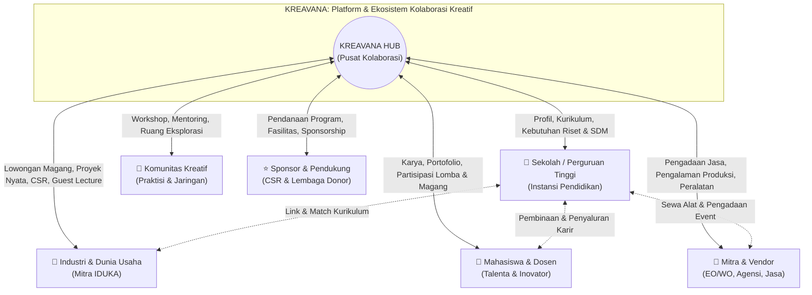
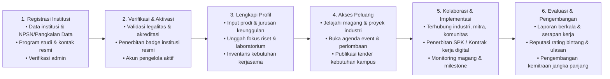

# Rancangan Ekosistem & Fitur: Role Sekolah / Perguruan Tinggi (Institution)
**Platform & Ekosistem Kolaborasi Kreatif Kreavana**
*Menghubungkan Talenta, Ilmu Pengetahuan dan Peluang untuk Masa Depan yang Lebih Baik*

---

## 1. Eksekutif Ringkasan & Filosofi Desain

> **Visi:** "Kreavana membantu sekolah dan perguruan tinggi membangun jejaring, menemukan peluang kolaborasi, serta mengembangkan potensi mahasiswa, pendidik, dan institusi."  
> **Tagline:** *Kolaborasi Hari Ini, Generasi Masa Depan.*  
> **Prinsip Utama:** *Kreavana — Lebih dari Sekadar Platform, Ini Adalah Ekosistem.*

Infografis mendefinisikan institusi pendidikan bukan hanya sebagai pengguna pasif pencari vendor, melainkan **pusat inkubasi talenta, riset, dan mitra strategis** yang terhubung secara timbal balik (*bidirectional value exchange*) dengan 5 pilar entitas lainnya:
1. **Mahasiswa & Dosen (Civitas Academica)**
2. **Industri & Dunia Usaha (IDUKA / Corporate)**
3. **Komunitas Kreatif**
4. **Mitra & Vendor (Event Organizer, Agensi Kreatif, Rumah Produksi)**
5. **Sponsor & Lembaga Pendukung (CSR, Hibah, Pemerintah)**

---

## 2. Diagram Hub Ekosistem Terpusat



---

## 3. Matriks Nilai Timbal Balik (Value Exchange Matrix)

Rancangan ini mengadopsi 4 kuadran nilai utama sesuai dengan infografis:

| Entitas | Manfaat yang Didapat | Manfaat yang Diberikan ke Kreavana | Pemetaan Modul Sistem Kreavana |
| :--- | :--- | :--- | :--- |
| **🏫 Sekolah / Perguruan Tinggi** *(Instansi Pendidikan)* | • Akses ke peluang magang, proyek penelitian, dan kolaborasi industri<br>• Penguatan jejaring dengan dunia usaha & komunitas kreatif<br>• Peningkatan reputasi dan daya saing institusi (akreditasi)<br>• Sarana promosi kegiatan & prestasi mahasiswa/dosen | • Data profil institusi, program studi, dan akreditasi keunggulan<br>• Informasi kebutuhan riset, SDM, dan proyek kolaborasi<br>• Rekomendasi program, event, dan talenta unggulan siswa<br>• Kontribusi aktif dalam ekosistem pendidikan & kreatif | • `school_dashboard_screen.dart`<br>• `institution_workspace_screen.dart`<br>• `profil_instansi` (Program Studi & Keunggulan)<br>• `agenda_screen.dart` |
| **👥 Mahasiswa & Dosen** *(Civitas)* | • Akses langsung ke lowongan magang, proyek freelance, & perlombaan<br>• Pengembangan keterampilan & portofolio terverifikasi<br>• Jaringan mentor profesional dan industri nyata<br>• Pengalaman kerja nyata (*real-world case studies*) | • Profil digital, riwayat minat, keahlian teknis, dan portofolio karya<br>• Partisipasi aktif dalam kegiatan, seminar, & kompetisi<br>• Umpan balik rating & ide-ide kreatif segar<br>• Kontribusi regenerasi talenta dalam ekosistem | • `showcases` (Karya & Portofolio Siswa)<br>• `explore_screen.dart`<br>• `creator_application_page.dart`<br>• Sistem sertifikat & badge kompetensi |
| **🤝 Mitra / Vendor** *(EO, WO, Agensi, Jasa)* | • Akses proyek dan tender pengadaan resmi dari kampus/sekolah<br>• Sarana promosi layanan alat, jasa produksi, dan event kampus<br>• Kesempatan membangun kemitraan jangka panjang (MoU)<br>• Ekspansi pasar di kalangan instansi pendidikan | • Informasi katalog layanan, portofolio, dan kapasitas operasional<br>• Penawaran harga khusus institusi & skema kolaborasi<br>• Dukungan resource/peralatan untuk pameran & wisuda<br>• Testimoni, rekam jejak kerja sama, dan verifikasi reputasi | • `tenders` (Tender & Pengadaan Vendor)<br>• `partners` (Direktori Mitra Aktif)<br>• `job_contract_service.dart`<br>• `opportunity_review_dialog.dart` |
| **🏢 Industri & Dunia Usaha** *(IDUKA / Corporate)* | • Akses instan ke bibit talenta muda berkualitas dan siap kerja<br>• Peluang hilirisasi riset, inovasi produk, dan studi terapan<br>• Kegiatan employer branding & rekrutmen efisien<br>• Penyaluran program CSR berdampak tinggi | • Informasi kebutuhan talenta spesifik, riset, dan proyek industri<br>• Dukungan program magang, sponsor alat, dan fasilitas riset<br>• Praktisi mengajar (*Guest Lecturer*) & mentor industri<br>• Studi kasus industri dan studi kelayakan lapangan | • `buat_kebutuhan_screen.dart`<br>• `peluang_proyek_screen.dart`<br>• Rekam jejak eksternal & internal rating<br>• Modul MoU Kemitraan Kampus-Industri |

---

## 4. Alur Kerja Role Sekolah / Perguruan Tinggi (6 Tahap Pipeline)



### Rincian Perilaku Tiap Tahapan:
1. **Tahap 1 - Registrasi Institusi:**
   - Input identitas: Nama Sekolah/Kampus, Jenjang (SMK, Politeknik, Universitas), Nomor Induk (NPSN/PDDikti), Website, dan Alamat.
   - Pendaftaran akun staf penanggung jawab (Koordinator Hubungan Industri / BKK / LPPM).
2. **Tahap 2 - Verifikasi & Aktivasi:**
   - Validasi oleh Administrator Kreavana melalui dashboard admin (`admin_verification_screen.dart`).
   - Pemberian status terverifikasi (`is_verified = true`) dan hak akses membuka program.
3. **Tahap 3 - Lengkapi Profil Institusi:**
   - Manajemen Daftar Program Studi / Kejuruan (misal: Desain Komunikasi Visual, Rekayasa Perangkat Lunak, Multimedia, Seni Rupa).
   - Profil fasilitas, keunggulan riset, serta kebutuhan kerja sama aktif.
4. **Tahap 4 - Akses & Buka Peluang:**
   - Menelusuri peluang magang terbuka dari Corporate/IDUKA di `peluang_proyek_screen.dart`.
   - Menerbitkan tender pengadaan barang/jasa kegiatan kampus di `buat_kebutuhan_screen.dart`.
   - Mengatur agenda kegiatan sekolah dengan tanggal awal s/d akhir di `agenda_screen.dart`.
5. **Tahap 5 - Kolaborasi & Implementasi:**
   - Komunikasi langsung via chat 1-on-1 dengan PIC industri di `direct_message_screen.dart`.
   - Kontrak kerja digital (`JobContract`) untuk memastikan kepastian honor/benefit magang, ruang lingkup, dan hak cipta.
6. **Tahap 6 - Evaluasi & Pengembangan:**
   - Monitoring realisasi anggaran di `institution_workspace_screen.dart` (`budgets`).
   - Penilaian kinerja saling memberi ulasan bintang di `opportunity_review_dialog.dart`.
   - Ekspor laporan evaluasi berkala untuk akreditasi BAN-PT / LAM / Akreditasi Sekolah.

---

## 5. Fitur Utama Role Sekolah / Perguruan Tinggi

### A. Profil Institusi & Program Studi
* **Fitur:** Manajemen identitas lembaga, daftar fakultas/jurusan, visi misi, capaian akreditasi, serta daftar fasilitas pendukung.
* **Integrasi UI:** `profile_screen.dart` dan tab khusus *Profil Institusi* di workspace.

### B. Manajemen Kegiatan, Event, & Lomba
* **Fitur:** Pembuatan dan publikasi acara tahunan (Dies Natalis, Expo Vokasi, Pameran Seni, Hackathon Kampus).
* **Integrasi Waktu:** Tampilan rentang tanggal awal s/d akhir lengkap dengan tahun (`agenda_screen.dart`), integrasi rating rekam jejak eksternal (`external_rating`).

### C. Peluang Magang, Riset Terapan, & Proyek Nyata
* **Fitur:** *Link & Match* otomatis antara mahasiswa/siswa dengan lowongan magang industri kreatif. Dosen pembimbing dapat memantau penempatan anak bimbingan secara terpadu.

### D. Direktori Mitra & Industri (MoU Tracker)
* **Fitur:** Buku induk kemitraan instansi (`partners`). Mencatat tanggal mulai MoU, masa berlaku, status nota kesepahaman aktif, dan kontak person industri.

### E. Sistem Rekrutmen & Penelusuran Talenta Mahasiswa
* **Fitur:** Showcase galeri karya portofolio siswa (`showcases`). Industri dapat langsung meninjau karya visual, video sinematik, desain 3D, atau kode program buatan siswa lalu mengirim tawaran magang.

### F. Dashboard Analitik & Laporan Kinerja
* **Fitur:** 
  * Grafik tren kolaborasi tahunan (Line Chart)
  * Distribusi serapan mitra dan kategori program (Donut Chart)
  * Monitoring realisasi anggaran & penyerapan dana kegiatan (`budgets`)
  * Rekapitulasi dokumen resmi instansi (`documents`)

---

## 6. Dampak yang Dirasakan (Impact Metrics)

```
┌────────────────────────────────────────────────────────────────────────┐
│                          DAMPAK YANG DIRASAKAN                         │
├───────────────────┬───────────────────┬───────────────────┬────────────┤
│ 🎓 LULUSAN UNGGUL │ 🌐 JEJARING LUAS  │ 💡 INOVASI RISET  │ 📈 REPUTASI│
│ Peningkatan kuali-│ Jejaring industri │ Riset & karya ter-│ Reputasi & │
│ tas lulusan siap  │ & mitra IDUKA yang│ terap terhilirkan │ akreditasi │
│ kerja & portofolio│ lebih luas & ter- │ secara berkelan-  │ institusi  │
│ industri nyata    │ rekam digital     │ jutan ke industri │ meningkat  │
└───────────────────┴───────────────────┴───────────────────┴────────────┘
```

---

## 7. Rencana Struktur Data & API (Technical Specification)

### A. Tabel Database Baru/Tambahan: `institution_study_programs`
```sql
CREATE TABLE `institution_study_programs` (
    `id` BIGINT UNSIGNED AUTO_INCREMENT PRIMARY KEY,
    `institution_id` BIGINT UNSIGNED NOT NULL,
    `faculty` VARCHAR(150) NULL,
    `name` VARCHAR(150) NOT NULL,
    `level` ENUM('SMK', 'D3', 'D4', 'S1', 'S2', 'Profesi') NOT NULL,
    `accreditation` VARCHAR(20) DEFAULT 'Unggul',
    `focus_areas` TEXT NULL,
    `total_students` INT UNSIGNED DEFAULT 0,
    `head_of_program` VARCHAR(150) NULL,
    `contact_email` VARCHAR(150) NULL,
    `created_at` TIMESTAMP NULL,
    `updated_at` TIMESTAMP NULL,
    FOREIGN KEY (`institution_id`) REFERENCES `users`(`id`) ON DELETE CASCADE
);
```

### B. Tabel Database: `institution_partnerships` (MoU Tracker)
```sql
CREATE TABLE `institution_partnerships` (
    `id` BIGINT UNSIGNED AUTO_INCREMENT PRIMARY KEY,
    `institution_id` BIGINT UNSIGNED NOT NULL,
    `partner_user_id` BIGINT UNSIGNED NULL,
    `partner_name` VARCHAR(200) NOT NULL,
    `category` ENUM('Industri', 'Vendor', 'Komunitas', 'Pemerintah', 'Sponsor') NOT NULL,
    `mou_number` VARCHAR(100) NULL,
    `start_date` DATE NOT NULL,
    `end_date` DATE NOT NULL,
    `scope_of_work` TEXT NULL,
    `status` ENUM('Aktif', 'Menunggu Perpanjangan', 'Selesai') DEFAULT 'Aktif',
    `document_url` VARCHAR(255) NULL,
    `created_at` TIMESTAMP NULL,
    `updated_at` TIMESTAMP NULL,
    FOREIGN KEY (`institution_id`) REFERENCES `users`(`id`) ON DELETE CASCADE
);
```

### C. Rute API Backend Baru (`backend/routes/api.php`):
* `GET /api/institution/ecosystem/overview` — Ringkasan metrik 4 kuadran & status 6 alur kerja.
* `GET /api/institution/study-programs` — Mengambil daftar jurusan/prodi institusi.
* `POST /api/institution/study-programs` — Tambah prodi & keunggulan.
* `GET /api/institution/partnerships` — Mengambil daftar kemitraan MoU aktif.
* `POST /api/institution/partnerships` — Menambahkan kemitraan industri baru.
* `GET /api/institution/talents` — Menelusuri talenta siswa terhubung dan showcase karyanya.

---

## 8. Rencana Implementasi Visual di Frontend Flutter

1. **Komponen Visual Infografis Interaktif (`EcosystemHubCard`):**
   - Menambahkan banner/widget interaktif di [school_dashboard_screen.dart](file:///c:/laragon/www/kreavana/frontend/lib/features/dashboard/screens/school_dashboard_screen.dart) yang menampilkan diagram 6 entitas dan alur 6 tahap ini secara visual dan responsif.
   - Menggunakan warna resmi sesuai infografis:
     * Ungu Institusi (`#4F46E5` / `#6366F1`)
     * Merah Marun Mahasiswa (`#991B1B` / `#DC2626`)
     * Oranye Vendor (`#EA580C` / `#F97316`)
     * Teal Industri (`#0D9488` / `#14B8A6`)
2. **Tab Khusus "Peta Ekosistem & Alur" pada Sidebar Institusi:**
   - Akses mudah bagi pimpinan sekolah/kampus untuk melihat kemajuan institusinya dalam siklus 6 tahap kolaborasi Kreavana.
