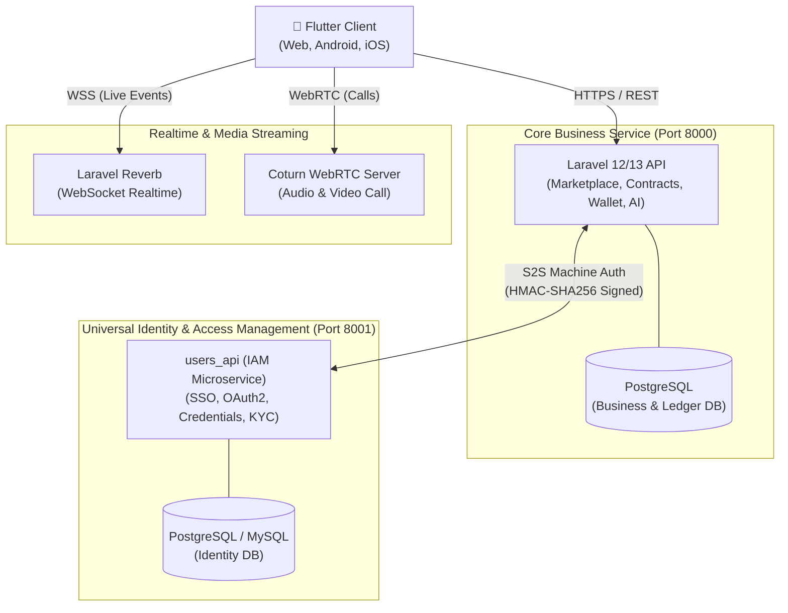

# 🚀 Kreavana Creative Ecosystem

> **Platform Terpadu Ekosistem Ekonomi Kreatif Indonesia**: Menghubungkan kreator, klien korporat/UMKM, agensi, dan institusi pendidikan melalui sistem kolaborasi cerdas, kontrak kerja aman, dan arsitektur *microservices* berstandar keamanan industri teknologi tingkat tinggi (*Big Tech Enterprise Grade*).

---

## 🏛️ Arsitektur Sistem (Ecosystem Architecture)

Kreavana dibangun dengan pendekatan **Microservices & Backend-for-Frontend (BFF)** terdesentralisasi:



### 1. `frontend` (Flutter Multiplatform)
- **Teknologi**: Flutter 3.x (Web, Android APK/AAB, iOS).
- **Fungsi**: Antarmuka interaktif responsif untuk eksplorasi peluang, manajemen proyek, negosiasi kontrak, percakapan langsung, video/voice call WebRTC, dan dompet digital.

### 2. `backend` (Core Business & BFF Gateway)
- **Teknologi**: Laravel 12/13, PostgreSQL, Redis, Laravel Reverb.
- **Fungsi**: Mengelola seluruh logika bisnis aplikasi (kontrak kerja, negosiasi, portofolio kreator, kuota storage, langganan tier, AI Engine, dan dompet digital).
- **Peran**: Bertindak sebagai *Resource Server* dan *BFF Gateway*. Tidak lagi menyimpan kata sandi pengguna secara lokal.

### 3. `users_api` (Universal Identity & Access Management - IAM)
- **Teknologi**: Standalone Laravel Microservice, JWT Auth, OpenID Connect.
- **Fungsi**: Pusat identitas tunggal (*Single Sign-On*), pengelolaan kredensial kata sandi, verifikasi legal KYC (KTP/NIB), dan sesi multi-perangkat (*Multi-Device Session Registry*).

---

## 🛡️ Standar Keamanan Industri Big Tech (Enterprise Security)

Kreavana menerapkan prinsip keamanan berlapis (*Defense in Depth*) yang mengacu pada standar **OWASP Top 10 API Security**, **NIST SP 800-63B**, dan **Zero Trust Architecture (NIST SP 800-207)**:

### 1. Zero-Knowledge Password Storage (Decoupled IAM)
- Kolom `password` pada tabel `users` di backend telah **dihapus secara permanen**.
- Kredensial rahasia hanya tersimpan di microservice `users_api` dalam bentuk hash memory-hard (**Argon2id / Bcrypt**).
- Backend menggunakan pola **Shadow User Synchronization** (`UsersApiClient::syncShadowUser`): hanya mengelola atribut bisnis dan hak akses tanpa menyentuh data rahasia.

### 2. Machine-to-Machine (S2S) Cryptographic Authentication
Setiap komunikasi antara `backend` dan `users_api` diotentikasi secara kriptografis menggunakan 4 header keamanan mesin:
- `X-Client-Id`: ID aplikasi klien yang terdaftar.
- `X-Timestamp`: Epoch UNIX timestamp saat request dibuat.
- `X-Correlation-Id`: UUIDv4 untuk *distributed tracing* lintas server.
- `X-Signature`: Tanda tangan digital **HMAC-SHA256**:
  $$\text{Signature} = \text{HMAC-SHA256}(client\_id \,.\, timestamp \,.\, raw\_body, \, client\_secret)$$
- **Anti-Replay Attack Protection**: Deviasi waktu (*clock drift*) antar-server dibatasi maksimal 300 detik (5 menit). Request di luar batas ini otomatis ditolak (`401 Unauthorized`).

### 3. Arsitektur Fail-Closed (Anti-Downgrade Attack)
- Jika microservice identitas (`users_api`) tidak dapat dijangkau, backend secara konsisten merespons dengan **Fail-Closed (`503 Service Unavailable`)**.
- Tidak ada mekanisme *fallback* ke autentikasi lokal lama untuk mencegah serangan *downgrade*.

### 4. Integritas Ledger Dompet & Keuangan (Cryptographic Ledger Chain)
- Setiap transaksi mutasi saldo (`wallet_transactions`) dilindungi tanda tangan kriptografis **`ledger_hash` (HMAC-SHA256)** yang dirantai ke transaksi sebelumnya.
- Manipulasi saldo langsung pada baris database akan terdeteksi sebagai anomali data.
- Saldo default untuk akun baru adalah **Rp 0,00**.

### 5. Distributed Session Revocation & Suspension
- Jika pengguna melakukan *Logout All Devices* atau disuspend pada `users_api`, IAM mem-broadcast notifikasi pembatalan sesi secara *real-time* ke endpoint internal backend (`/api/internal/v1/sessions/revoke`).
- Token pengguna langsung dibatalkan melalui `JtiService::revoke()` dan middleware `CheckUserSuspended`.

---

## ⚙️ Panduan Menjalankan Sistem Secara Lokal (Quickstart)

### Prasyarat
- PHP >= 8.3 / 8.4 dengan ekstensi `pdo_pgsql`, `pdo_mysql`, `curl`, `mbstring`, `openssl`, `sodium`.
- Composer >= 2.x
- PostgreSQL >= 15 & Redis Server
- Flutter SDK Stable (>= 3.24.x)
- Docker & Docker Compose (opsional, untuk Coturn WebRTC)

---

### Langkah 1: Menjalankan Universal Identity Service (`users_api`)

```bash
cd users_api

# 1. Install dependensi
composer install

# 2. Setup environment
cp .env.example .env
# Sesuaikan koneksi DB_DATABASE di .env

# 3. Generate key & JWT Secret
php artisan key:generate
php artisan jwt:secret --force

# 4. Migrasi database & seeder
php artisan migrate --seed

# 5. Jalankan service pada port 8001
php artisan serve --host=0.0.0.0 --port=8001
```

*Verifikasi endpoint*:
- Health Check: `http://127.0.0.1:8001/api/health`
- OpenID Discovery: `http://127.0.0.1:8001/api/.well-known/openid-configuration`

---

### Langkah 2: Menjalankan Core Business Backend (`backend`)

```bash
cd backend

# 1. Install dependensi
composer install

# 2. Setup environment
cp .env.example .env

# Pastikan konfigurasi integrasi IAM aktif di backend/.env:
# USERS_API_URL=http://127.0.0.1:8001
# USERS_API_CLIENT_ID=kreavana_app
# USERS_API_CLIENT_SECRET=c8b0e656e34be991a1905d33cdc1be761bed722a74536eccaad391971ef4fae4

# 3. Generate App Key & JWT Secret
php artisan key:generate
php artisan jwt:secret --force

# 4. Migrasi database & seeder
php artisan migrate --seed

# 5. Jalankan WebSocket Realtime Reverb (Terminal terpisah)
php artisan reverb:start

# 6. Jalankan Server API pada port 8000
php artisan serve --host=0.0.0.0 --port=8000
```

*(Opsional)* Untuk fitur Voice & Video Call WebRTC:
```bash
docker compose up -d
```
*(Sesuaikan IP local Coturn pada file `coturn/turnserver.conf`).*

---

### Langkah 3: Menjalankan Frontend (`frontend`)

```bash
cd frontend

# 1. Ambil dependensi Flutter
flutter pub get

# 2. Jalankan aplikasi (Flutter Web)
flutter run -d chrome

# Atau jalankan hasil build produksi lokal:
flutter build web --release --no-wasm-dry-run
npx serve -s frontend/build/web -l tcp://127.0.0.1:5001
```

#### Perintah Build Rilis Frontend:
* **APK Android Rilis**:
  ```bash
  flutter build apk --obfuscate --split-debug-info=./debug_info --release --android-skip-build-dependency-validation
  ```
* **Android App Bundle (AAB)**:
  ```bash
  flutter build appbundle --obfuscate --split-debug-info=./debug_info --release --android-skip-build-dependency-validation
  ```
* **Flutter Web Staging / Dev**:
  ```bash
  flutter build web --dart-define=ENV=staging --no-wasm-dry-run
  ```

---

## 📋 Kebijakan Alur Kerja Git & Kontribusi (Git Workflow)

Repositori ini menerapkan **Prosedur Wajib 6 Langkah Git** yang terdokumentasi lengkap di [`.github/rules/git-workflow.md`](.github/rules/git-workflow.md):

1. **Pull Main Terbaru:** Wajib `git checkout main && git pull origin main` sebelum membuat branch baru.
2. **Branch Konvensional:** Buat branch `feature/`, `fix/`, `refactor/`, atau `chore/`.
3. **Commit Lokal Teruji:** Uji kode (`php -l`, build check) sebelum melakukan `git commit`.
4. **Wajib Merge Lokal dari Main:** Sebelum melakukan push, merge `main` terbaru ke branch kerja lokal untuk memastikan bebas konflik.
5. **Push Branch Kerja ke Remote Origin.**
6. **Merge ke Main & Push ke Remote Origin.**

### 🤖 Kebijakan Khusus Asisten AI (Claude & Antigravity)
- **Aturan Claude ([`CLAUDE.md`](CLAUDE.md)):** Model Claude (Anthropic / Claude Code / Desktop) **DILARANG KERAS mengeksekusi `git push`** agar tidak tercatat sebagai kontributor/committer di GitHub. Claude hanya diizinkan memodifikasi kode lokal dan menyerahkan instruksi push kepada pengguna atau Antigravity.
- **Aturan Antigravity:** Agen resmi berhak melakukan commit dan push sesuai alur kerja 6 langkah yang ketat.

---

## 📄 Lisensi & Hak Cipta
Hak Cipta © 2026 **Kreavana Creative Ecosystem**. Seluruh hak cipta dilindungi undang-undang.
